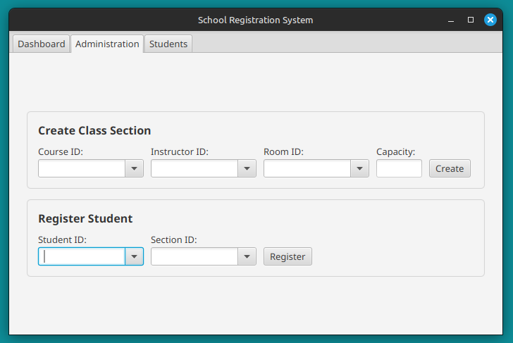

<p align="center">
  
  
  
</p>

<h1 align="center">
  School Registration System
</h1>

<p align="center">
  A desktop administrative application for a college registrar.
</p>

<p align="center">
  
</p>

## Table of Contents
* [Prerequisites](#Prerequisites)
* [Quick Start](#quick-start)
* [Features](#features)
* [Project File Structure](#project-file-structure)
* [Future Features](#future-features)

## Prerequisites
- Java Development Kit (JDK) 21+.
```
sudo apt install default-jdk # for compiling and running Java app
```
- A build tool such as Maven or Gradle.

## Quick Start

```bash
mvn clean javafx:run
```

## Features
- Data Persistence
- Search and Filter
- Waitlist System

## Project File Structure

```
school-registration-system
├── data
│   ├── Classroom.csv
│   ├── ClassSession.csv
│   ├── Course.csv
│   ├── Instructor.csv
│   └── Student.csv
└── src
    ├── main
    │   ├── java
    │   │   └── com
    │   │       └── school
    │   │           └── app
    │   │               ├── controller
    │   │               │    ├── AdministrationSceneController.java
    │   │               │    ├── DashboardSceneController.java
    │   │               │    ├── StudentSceneController.java
    │   │               │    └── MainSceneController.java
    │   │               ├── model
    │   │               │    ├── ClassSession.java
    │   │               │    ├── Classroom.java
    │   │               │    ├── Course.java
    │   │               │    ├── Instructor.java
    │   │               │    └── Student.java
    │   │               ├── service
    │   │               │    ├── ClassroomService.java
    │   │               │    ├── RegistrationService.java
    │   │               │    ├── CourseService.java
    │   │               │    ├── InstructorService.java
    │   │               │    └── StudentService.java
    │   │               └── Main.java
    │   └── module-info.java
    └── resources
        └── com
            └── school
                └── app
                    └── view
                        ├── administrationScene.fxml
                        ├── dashboardScene.fxml
                        ├── studentScene.fxml
                        └── mainScene.fxml
```

## Future Features
- Implement container database
- Publish Java Package with Maven [workflow link](https://github.com/actions/setup-java/blob/main/docs/advanced-usage.md#apache-maven-with-a-settings-path)
- Add Sql database support and integration
- investigate package/binary distribution to different OSs
